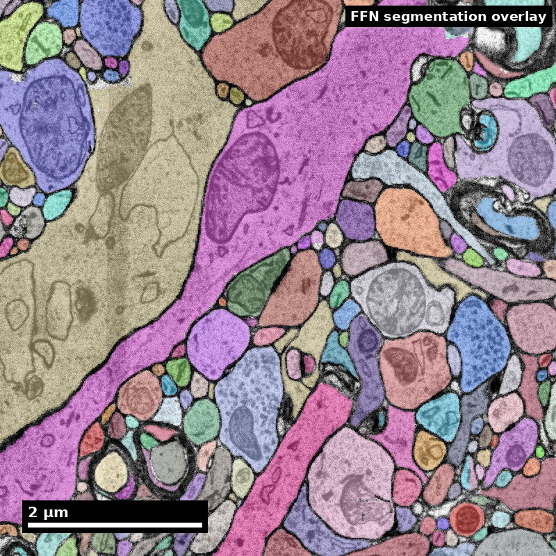
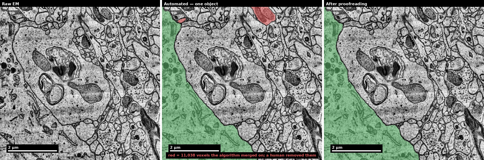

<!-- _class: title nanoscale -->

Nanoscale · Module 07

# Proofreading and Quality Control
Teaching Deck

Human cortex · H01 Object segmentation over electron microscopy

H01 release · Lichtman Lab / Harvard &amp; Connectomics at Google · CC BY 4.0 Shapson-Coe et al. (2024) · doi:10.1126/science.adk4858

---

## Learning Objectives
- Prioritize proofreading tasks by scientific impact
- Apply consistent adjudication rules
- Use quality metrics to support release decisions
- Document uncertainty and unresolved issues

---

## Capability Target
Execute a proofreading triage cycle that ranks corrections by impact and issues a transparent QC decision.

---

## Concept Focus
### 1) Impact-weighted triage
Not all errors are worth fixing. A merge error on a large interneuron with 500 synapses is far more impactful than a split error on a tiny axon fragment with 2 synapses. Impact factors include: (a) size of the affected segment (larger = more connections affected), (b) position in the analysis region of interest, (c) error type (merges corrupt the graph more directly than splits), (d) confidence of the error detection (is it definitely wrong or ambiguous?).

---

## Core Workflow
- **Classify** errors by type (merge/split/boundary) and estimated impact (high/medium/low). Use the error taxonomy from the content library as a reference checklist.
- **Prioritize** correction queue: high-impact merges first, then splits in the region of interest, then boundary errors. Defer or discard low-impact errors outside the analysis region.

---

## Core Workflow (continued)
- **Apply** corrections using Neuroglancer/CAVE split and merge operations. For each correction, note the supervoxel IDs involved and the evidence that motivated the edit.

---

## Core Workflow (continued)
- **Verify** each correction: check that the fix didn't introduce new errors.
- **Record** QC decision: compute metrics, compare to release thresholds, issue go/rework recommendation. If the recommendation is "rework," specify which error categories need further attention and estimate the additional effort required.

<!--
Further teaching detail from the module:
**Verify** each correction: check that the fix didn't introduce new errors. Splitting a merge sometimes creates an orphan fragment that needs re-merging elsewhere. Merging a split sometimes absorbs a nearby fragment that shouldn't be included. Always inspect the result in at least two orthogonal views.
-->

---

## Run of Show (60 min)
- 00:00-10:00 | Triage philosophy
- 10:00-24:00 | Queue classification exercise
- 24:00-38:00 | Correction sprint
- 38:00-50:00 | Threshold-based release decisions
<!--
Pre-class preparation (10 min async)
  Read the proofreading strategies content library entry
  Review the worked examples content library entry (at least Scenario 1 and 4)
  Minute-by-minute plan

00:00-10:00 | Triage philosophy
  Open with: "You have 100 errors flagged in your volume and time to fix 20. Which 20 do you choose?"
  Discuss: visual salience does not equal scientific importance. The ugliest error (a weird tentacle from a merge) may be less important than a subtle split in a key neuron.
  Introduce impact-weighting framework.
  Show a concrete example: two errors side by side, one visually dramatic but low-impact, one subtle but high-impact. Ask learners which they would fix first and why.

10:00-24:00 | Queue classification exercise
  Present 12 pre-identified errors with brief descriptions. Learners work in pairs to:
  Classify each by type (merge/split/boundary)
  Estimate impact (high/medium/low) based on segment size and analysis relevance
  Rank the top 5 for correction
  Debrief: compare rankings across pairs. Where do teams disagree? Disagreements often reveal implicit assumptions about what matters.

24:00-38:00 | Correction sprint
  Learners fix their top 5 errors in the practice dataset.
  Instructor circulates: "Show me why you think this is a merge error." "What evidence did you check before splitting?"
  Emphasis on verification after each correction.
  Common pitfall to watch for: learners who split a merge but forget to re-merge the orphaned fragment with the correct parent segment.

38:00-50:00 | Threshold-based release decisions
  Compute metrics before and after the correction sprint.
  Introduce release thresholds: "If ERL > 30 um and synapse F1 > 0.80, we release. If not, more proofreading."
  Group discussion: are we above threshold? If not, what would we fix next?
  Key teaching moment: the threshold should be set before proofreading begins, not adjusted after seeing the results. Moving the goalposts undermines the purpose of having thresholds.

50:00-60:00 | Competency check
  Each learner writes a 4-sentence "release recommendation memo":
  Current quality metrics
  What was fixed
  What remains unfixed and why
  Go/no-go recommendation
  Exit ticket: "One rule for when an error MUST be fixed before release."
-->

---

## Run of Show (60 min) (continued)
- 50:00-60:00 | Competency check

---

## Misconceptions to Watch
- **Misconception guardrail:** proofreading is cleanup that ends when the data looks right, rather than an allocation problem under a fixed budget.
- **Misconception guardrail:** a single aggregate quality score is enough to decide whether a release is good.
- **Misconception guardrail:** throughput is a sufficient measure of annotator performance without agreement statistics alongside it.
- **Misconception guardrail:** a result can be reported without stating the proofreading level of the cells it rests on.

---

<!-- _class: visual-lesson -->
## Review the edit, not just the final picture

Follow the field through an automated result and a human revision.

<figure><figcaption>Left: raw. Middle: automated. Right: after proofreading.</figcaption></figure>

<strong>Discuss:</strong> What should be recorded so another reviewer can audit the edit?

H01 release, Lichtman Lab / Harvard and Connectomics at Google; Shapson-Coe et al. (2024), doi:10.1126/science.adk4858; CC BY 4.0.

<!--
Visual description and discussion guidance:
In the middle panel the small upper-right selected region is removed in the final panel; the large lower-left selected region remains. This positional description supplements the green/red encoding. The example illustrates one edit, not a complete release audit.
-->

---

<!-- _class: visual-lesson -->
## Prioritize against the scientific endpoint

The most conspicuous error may not have the greatest impact.

<ol class="visual-steps"><li>1<h3>State the endpoint</h3>
Which result could change?
</li><li>2<h3>Review the risk</h3>
Weigh evidence, uncertainty and correction cost.
</li><li>3<h3>Record the decision</h3>
Fix, defer or request adjudication; document why.
</li></ol>

<strong>Discuss:</strong> When might deferring an edit be defensible?

Illustrative teaching scenario; see this module’s lesson and worked example.

<!--
Visual description and discussion guidance:
These are triage questions, not a universal ranking of merge and split errors. Unresolved uncertainty should stay visible in the release record even when a team defers an edit.
-->

---

## Studio Activity
**Scenario:** You are the QC lead for a 100x100x100 um subvolume that will be used in a paper analyzing reciprocal connectivity between L2/3 pyramidal cells. The segmentation has been through one round of automated error detection. You need to decide: is this subvolume ready for analysis?

---

## Activity Output Checklist
- Evidence-linked artifact submitted.
- At least one limitation or uncertainty stated.
- Revision point captured from feedback.

---

## Assessment Rubric
- **Minimum pass**: Consistent queueing by type and impact. Release decision justified by metrics. Correction log present.
- **Strong performance**: Impact reasoning explicitly tied to the scientific question (reciprocal connectivity).
- **Common failure to flag**: Ad hoc corrections without policy -- fixing whatever looks wrong rather than systematically prioritizing by impact. Another common failure is issuing a release recommendation without referencing specific metric values.

<!--
Further teaching detail from the module:
**Strong performance**: Impact reasoning explicitly tied to the scientific question (reciprocal connectivity). Uncertainty handling is transparent -- learner acknowledges what they could not determine and explains how that uncertainty affects the release decision. Memo is clear and actionable.
-->

---

## Exit Ticket
Write one rule for when an error must be fixed before release. Your rule should specify: (1) the type of error, (2) the condition under which it is mandatory to fix, and (3) why that condition matters for downstream analysis. Example format: "A [type] error must be fixed before release when [condition], because [scientific reasoning]."

---

## References (Instructor)
- Use module references listed on the module page.

---

## Teaching Materials
- Module page: /modules/module07/
- Session kit: /teaching/sessions/module07/
- Worksheet: /assets/worksheets/module07/module07-activity.md

---

<!-- _class: closing -->
## Read, review, or teach
[Read these slides as a page](module07.reader.html)

[Open the complete lesson](https://www.neurotrailblazers.org/modules/module07/)

The reading version includes figure descriptions and discussion guidance.

Nanoscale text: CC BY 4.0. Scientific figures retain their individual credits.

